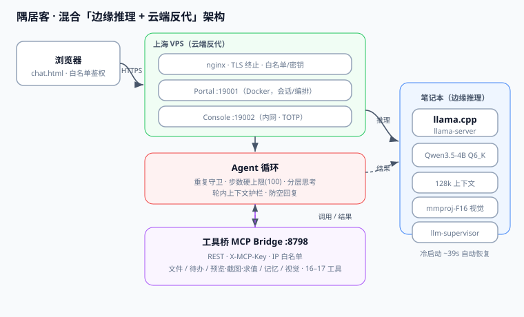

# 架构（Architecture）

隅居客是一个**混合「边缘推理 + 云端反代」**的私有 AI 助手服务栈。推理发生在用户的笔记本（边缘），网页入口与多用户服务经由一台公网 VPS（云端）安全暴露。后端已从文档级设计升级为**可运行参考实现**（NestJS + PostgreSQL + Redis + gRPC），详见 [`docs/backend-design.md`](./docs/backend-design.md)。

> 定位：技术演示与工程参考，**不涉及生产环境**（个人无法备案生成式 AI）。仓库不含任何密钥、凭证或真实用户数据。

## 架构图



## 组件分层

### 1. 客户端（Browser）
普通网页 `chat.html`（SPA），白名单鉴权；会话状态持久化在服务器端。

### 2. 云端服务层（Shanghai VPS）
| 组件 | 说明 |
|------|------|
| `nginx` | 反向代理 + TLS 终止；对外只暴露 HTTPS，内部走白名单 + 密钥 |
| Portal `:19001` | Docker 化的门户服务，承载聊天页、用户会话、工具调用编排 |
| Console `:19002` | 内网管理控制台（TOTP 保护，仅内网可达） |

### 3. 后端应用层（NestJS，参考实现）
| 模块 | 职责 |
|------|------|
| `AuthModule` | `WhitelistGuard`：白名单用户 + 内部共享密钥 |
| `ChatModule` | REST：`POST /chat/sessions`、`POST /chat/sessions/:id/messages`（DTO 校验） |
| `AgentModule` | Agent 循环：重复调用守卫 / 步数硬上限(100) / 写成功清非写计数 |
| `CacheModule` | Redis 封装：随机 TTL 防雪崩 / 空值防穿透 / 互斥锁防击穿 |
| `GrpcModule` | gRPC 客户端：调用边缘推理与工具桥（强类型、流式） |

### 4. 数据层（PostgreSQL + Prisma）
- `User / Session / Message(JSONB) / ToolCall / KnowledgeChunk(vector) / EvalRun`。
- Prisma 管理迁移与类型安全 client；JSONB 存半结构化消息，pgvector 存知识块向量。
- 详见 [`docs/data-model.md`](./docs/data-model.md)。

### 5. 缓存层（Redis）
- 会话回复、工具结果复用；三防护见 [`docs/caching-strategy.md`](./docs/caching-strategy.md)。

### 6. Agent 循环（Portal 内）
- 接收用户消息 → 调用边缘推理 → 解析工具调用意图。
- **安全/稳定性守卫**：
  - 重复调用守卫（同一工具+同参数第 3 次拒、第 5 次判 stuck）
  - 上下文窗口硬上限（100 步）
  - 轮内上下文护栏（最近 20 条消息，防爆窗）
  - 分层思考（首轮规划、中间轮执行）

### 7. 边缘推理节点（Laptop，本地 GPU）
- `llama.cpp`（`llama-server`）加载：
  - `Qwen3.5-4B-Uncensored` Q6_K 量化
  - `mmproj-F16`（视觉多模态）
- 上下文 **128k**（`SUP_CTX_SIZE=131072`，KV 缓存 q8_0）。
- `llm-supervisor` 托管：自动拉起、崩溃恢复；冷启动约 **39s**。

### 8. 工具桥（MCP Bridge，`python`，`:8798` → gRPC 化）
- 原 REST + `X-MCP-Key` + IP 白名单，已演进为 **gRPC + Protobuf**（强类型、流式），参见 [`docs/internal-protocol.md`](./docs/internal-protocol.md)。
- 暴露 **16–17 个工具**：文件读写/编辑、待办、网页预览/截图/求值、记忆、分享、视觉分析等。

## 数据流（Data flow）

```
浏览器 ──HTTPS(:19001)──▶ 上海 VPS (nginx → Portal/NestJS)
                                   │
                                   ├─▶ AuthModule (白名单)
                                   ├─▶ ChatModule (REST)
                                   ├─▶ AgentModule (循环)
                                   │     ├─▶ gRPC ▶ 笔记本 llama-server（推理，128k，流式 token）
                                   │     └─▶ gRPC ▶ 工具桥（文件/任务/检索/预览/记忆）
                                   ├─▶ CacheModule (Redis: 三防护)
                                   └─▶ Prisma ▶ PostgreSQL (持久化 + 向量检索)
```

- 用户消息经 VPS 进入 Agent 循环。
- 需要推理时，经 gRPC 转发至笔记本 `llama-server`（流式 token）。
- 需要工具时，经 gRPC 调用本地能力，结果回灌上下文。
- 会话/消息落 PostgreSQL，热点走 Redis。
- 最终响应经 VPS 回传浏览器。

## 为什么是混合架构

| 关注点 | 放在边缘（笔记本） | 放在云端（VPS） |
|--------|--------------------|------------------|
| 推理 | ✅ 隐私数据不出本机、零推理成本 | — |
| 多用户入口 | — | ✅ 稳定公网 IP、TLS、白名单 |
| 工具执行 | ✅ 直接访问本地文件/进程 | — |
| 鉴权/反代 | — | ✅ 统一网关、限流、审计 |
| 持久化 | — | ✅ PostgreSQL 关系模型 + 向量；Redis 缓存加速 |
| 服务间通信 | ✅ gRPC 强类型流式（推理↔编排↔工具） | — |
